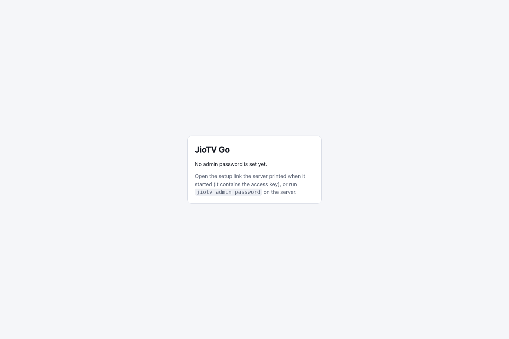

# First Launch and Admin Setup

JioTV protects the admin interface with a password and its playlist routes with an access key. The **admin password** belongs to this local installation; your JioTV account has a separate OTP sign-in.

1. Run `jiotv serve` on the host.
2. Look for **Web setup** in the terminal output. Open the full URL privately in your browser. The URL includes an access key.
3. Enter a password of eight or more characters, repeat it, then select **Set password**.
4. Return to the interface and verify that **Channels**, **On demand**, and **Settings** appear after sign-in.

This screenshot shows the **notice at the normal web address** before an admin password exists. Open the private **Web setup** URL printed in the terminal to reach the password form described in step 3.

If you do not have the setup link, you can run `jiotv admin password` in the server's terminal and set the password there. Store it safely. For a remote device, make sure you are opening the JioTV host, not your viewing device's own localhost.

**Never post the setup link, access key or server data directory.** For more protection, read [Network access and HTTPS](../configuration-network-security/index.md). Next: [connect JioTV](../account-connect-jiotv/index.md).
