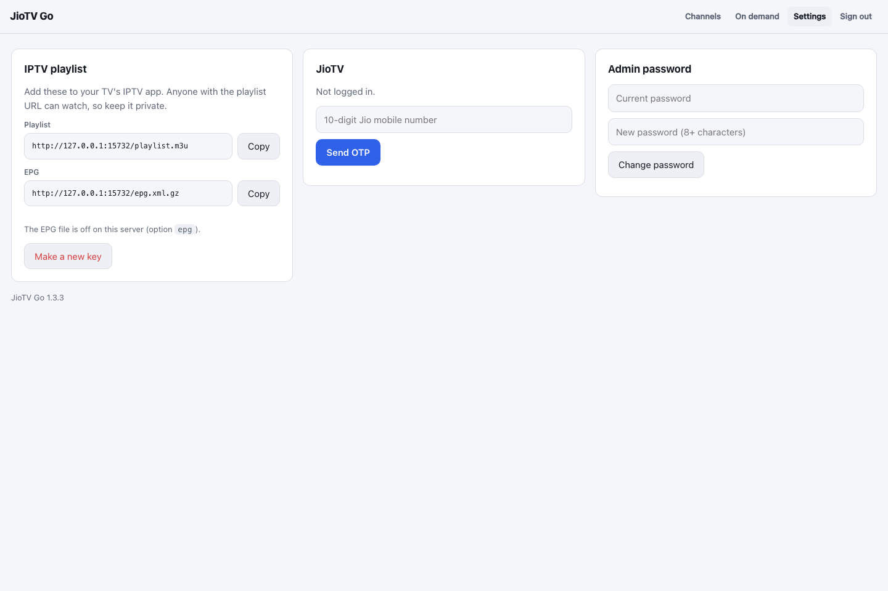

# Find Your Way Around the Web Interface

After entering your admin password, the top bar has **Channels**, **On demand**, **Settings** and **Sign out**. A small icon beside the brand indicates when Extras is both enabled and connected.

- **Channels** is the channel finder. Search by name or filter by category, language, HD or source. A channel tile opens the live player.
- **On demand** has sections, provider filters and search for available movies or shows. Availability depends on Extras/account connectivity.
- **Settings** shows account status, OTP sign-in controls, playlist and EPG URLs, password change, and access-key rotation.

When you select a channel, you get the full live player and programme details, including the schedule when provided. You can return using **All channels**. Sign out leaves the admin interface; it does not necessarily disconnect the separate JioTV provider account.

Continue with [live TV](../using-live-tv/index.md), [accounts](../account-connect-jiotv/index.md), or [IPTV playlists](../using-iptv-playlists/index.md).
