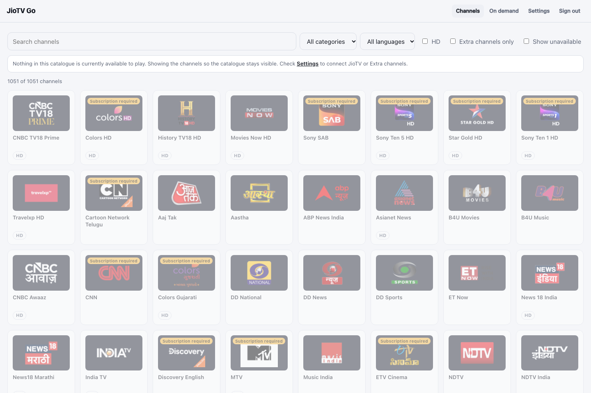

# Watch Your First Live Channel

Once your server is running and your JioTV account says **Logged in** in **Settings**, you can try live television.

1. Open **Channels** in the top bar. You should see a channel grid, a search box and filters.
2. Type the channel name in **Search channels**, or choose **All categories** or **All languages** to narrow the list.
3. Select a channel that your plan is allowed to watch. A **Subscription required** label means you may not have access.
4. Select its tile. The live player opens. Playback may need a moment to start.
5. Move the pointer over the player to show controls. Change quality, sound or full screen if those controls are offered.

**What you should see:** The screenshot shows where to search, but this demo server has *no JioTV account connected*, so it cannot play channels. When signed in, you can try a channel your plan permits.

If the player says **Subscription required**, try a channel included in your plan. If the player mentions **DRM**, **Widevine**, a license, or a secure origin, see [Fix DRM playback errors](../troubleshooting-protected-playback/index.md). If the screen remains loading, see [Fix a channel that will not play](../troubleshooting-channels-and-playback/index.md).

For programme information, read [Programme guide](../using-programme-guide/index.md). Catch-up support depends on the stream and player. To watch on a TV with an IPTV app, use [M3U playlists](../using-iptv-playlists/index.md).
