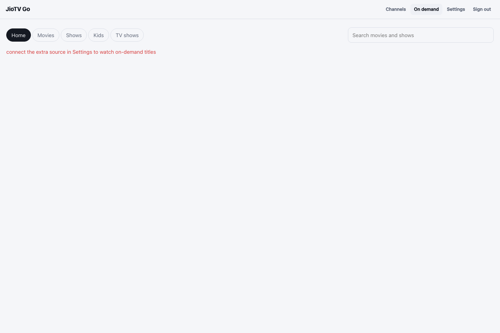

# Browse On-Demand Movies and Shows

The screenshot shows the current layout before connecting Extras. Available titles appear only when the matching catalogue and account are available.

1. Select **On demand** in the top navigation.
2. Choose **Home**, **Movies**, **Shows**, **Kids**, or **TV shows**.
3. Browse the available rows, or search for a movie or show by name.
4. Use provider chips, when shown, to limit the visible titles to a provider.
5. Select a title. For a series, choose a season and then an episode.
6. Select the play item to open the player. Use **Back** to return.

**Expected result:** the selected title's player opens if it is available to the connected account and provider. Catalogues and playback rights vary; an empty section or playback error can reflect account, provider, region, DRM or network limits.

For Extra channels account setup, see [Connect Extra Channels](../account-extras/index.md). For protected playback requirements, see [Requirements](../getting-started-requirements/index.md).
